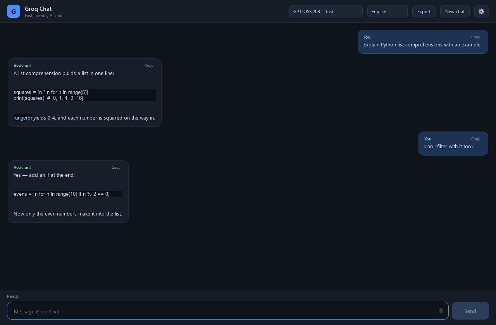
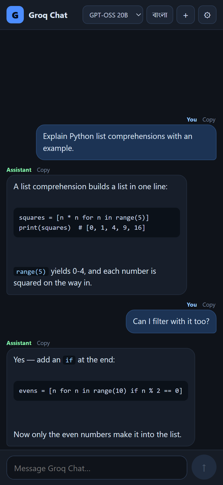
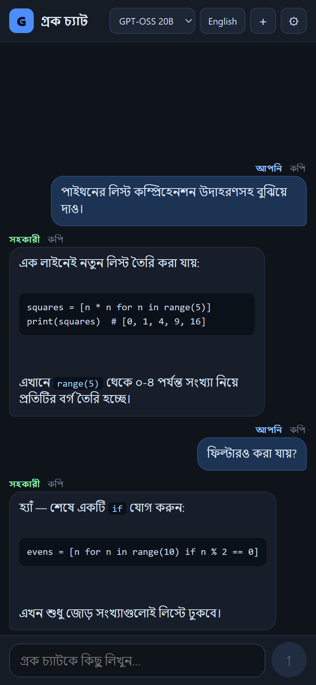
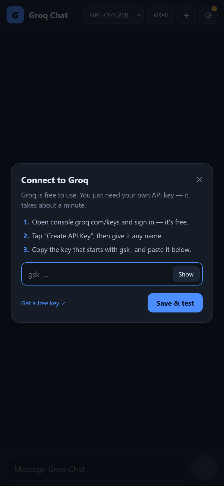
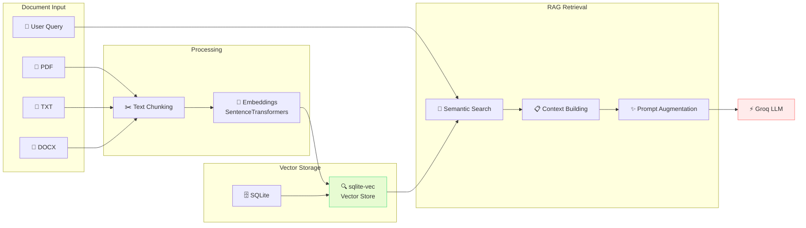
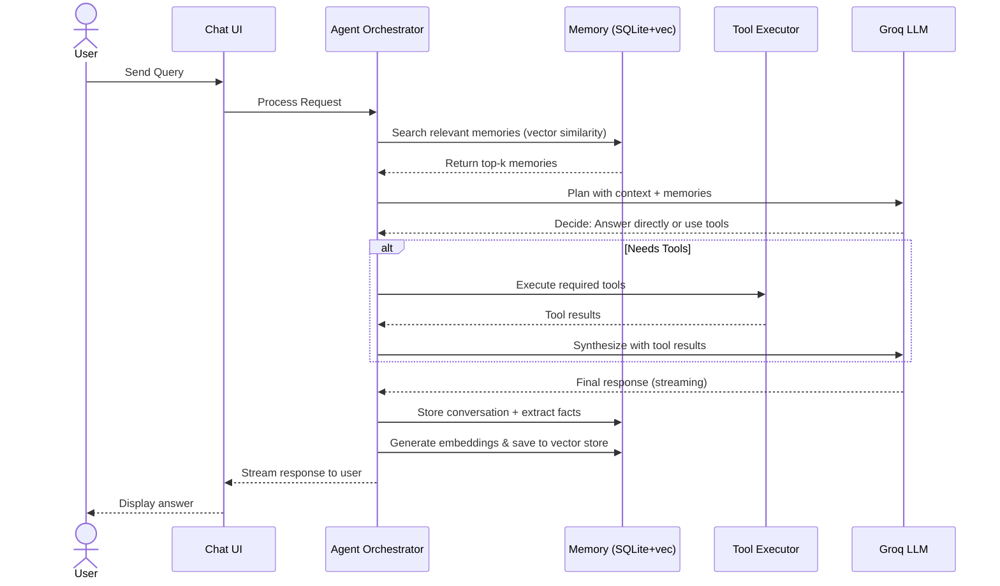

<p align="center">
  
</p>

<h1 align="center">GroqChatbot</h1>

<p align="center">
  <b>The Ultimate Bilingual AI Agent • Long-Term Memory • RAG • Image Generation • Tools • Cross-Platform</b><br>
  Powered by Groq's ultra-fast LPU inference with SQLite + sqlite-vec memory system
</p>

<p align="center">
  <a href="https://www.python.org/"></a>
  <a href="https://doc.qt.io/qtforpython/"></a>
  <a href="https://capacitorjs.com/"></a>
  <a href="https://github.com/asg017/sqlite-vec"></a>
  <a href="https://console.groq.com/"></a>
  <a href="LICENSE"></a>
</p>

<p align="center">
  <a href="https://github.com/rhasan2026g-cell/GroqChatbot/releases/latest"></a>
  <a href="#quick-start"></a>
</p>

> **No account • No backend • 100% private.** Bring your own Groq API key. Everything runs locally with persistent agent memory powered by SQLite + vector search.

## ✨ Key Features

- 🤖 **True AI Agent** - Tool calling, reasoning, task planning, and autonomous multi-step execution
- 🧠 **Long-Term Memory** - SQLite database with sqlite-vec for semantic vector search across all conversations
- 📚 **RAG System** - Upload documents (PDF, TXT, DOCX) and chat with them using retrieval-augmented generation
- 🎨 **AI Image Generation** - Create images with Flux, Stable Diffusion models
- 🖼️ **Illustration Generator** - Generate custom illustrations and artwork
- 🎵 **Music Generation** - Create AI music and soundtracks (coming soon with API keys)
- 🎬 **Video Generation** - Generate AI videos and animations (coming soon)
- 🌐 **Bilingual by Default** - Seamless English & বাংলা support with automatic language detection
- ⚡ **Lightning Fast** - Powered by Groq's ultra-fast LPU inference with real-time streaming
- 🛠️ **Built-in Tools** - Web search, calculator, file system access, code execution, weather, datetime, and more
- 🔐 **Privacy First** - API keys stay on your device. No telemetry, no analytics, no cloud sync
- 📱 **Cross-Platform** - Beautiful native-like experience on Windows, macOS, Linux, and Android
- 🎨 **Modern UI** - Clean, minimal interface with dark theme and smooth animations
- 💾 **Persistent Memory** - Remembers facts about you, past conversations, and context across sessions
- 🔍 **Semantic Recall** - Vector similarity search finds relevant memories even from weeks ago
- 📁 **Document Chat** - Upload and query your own documents with RAG

## 🎯 What Makes It Different

GroqChatbot isn't just a chat interface—it's an intelligent agent that learns, remembers, and acts. With SQLite + sqlite-vec integration, it builds a personal knowledge base of your interactions, allowing for truly contextual conversations that improve over time.

## 📸 Screenshots

<p align="center">
  
</p>
<p align="center"><i>Desktop agent with tool calling and streaming responses</i></p>

<table align="center">
  <tr>
    <td align="center"><br><b>Android (English)</b></td>
    <td align="center"><br><b>Android (বাংলা)</b></td>
    <td align="center"><br><b>Secure Key Setup</b></td>
  </tr>
</table>

## 🧠 Memory & RAG Architecture



## 🎨 AI Generation Capabilities

| Feature | Status | Models | Description |
|---------|--------|---------|-------------|
| 🖼️ **Image Generation** | ✅ Available | Flux, Stable Diffusion XL, SD 1.5 | Create stunning images from text prompts |
| 🎨 **Illustrations** | ✅ Available | Flux | Generate custom illustrations and artwork |
| 🎵 **Music Generation** | 🔄 Coming Soon | MusicGen, AudioGen | Create AI music, beats, and soundtracks |
| 🎬 **Video Generation** | 🔄 Coming Soon | Hunyuan Video, Kling, Pika | Generate AI videos from text prompts |
| 🎞️ **Animations** | 🔄 Coming Soon | AnimateDiff | Create short animations and GIFs |

> **Note:** Music and Video generation require additional API keys. Image generation works with HuggingFace API (free tier available).


## 🔄 Agent Workflow



## 🛠️ Built-in Agent Tools

| Tool | Description | Use Case |
|---|---|---|
| `web_search` | Search the web in real-time | Current events, facts, news |
| `calculator` | Evaluate mathematical expressions | Calculations, conversions |
| `get_current_time` | Get current time/date in any timezone | Scheduling, reminders |
| `file_read/write` | Read and write local files | Document processing, notes |
| `execute_python` | Run Python code safely in sandbox | Data analysis, automation |
| `weather` | Get weather information | Travel planning |
| `remember_fact` | Store important facts in long-term memory | User preferences, details |
| `recall_memory` | Semantic search through past conversations | Context retrieval |
| `summarize_conversation` | Summarize long conversations | Quick reviews |

## 🤖 Available Models

| Model | Speed | Capability | Best For |
|---|---|---|---|
| `openai/gpt-oss-20b` | ⚡⚡⚡ Very Fast | Great | General chat, quick tasks, coding help |
| `openai/gpt-oss-120b` | ⚡⚡ Fast | Excellent | Complex reasoning, agent tasks, analysis |
| `qwen/qwen3.8-27b` | ⚡⚡⚡ Very Fast | Great | Multilingual, creative tasks, Bengali responses |

## 🚀 Quick Start

### Prerequisites
- Python 3.10 or higher
- [Groq API Key](https://console.groq.com/keys) (free)
- Git

### Desktop Installation

```bash
# Clone the repository
git clone https://github.com/rhasan2026g-cell/GroqChatbot.git
cd GroqChatbot

# Create virtual environment
python -m venv .venv

# Activate (Windows)
.venv\Scripts\activate

# Activate (macOS/Linux)
source .venv/bin/activate

# Install dependencies
pip install -r requirements.txt

# Run the app
python "My Chatbot.py"
```

On first launch, you'll be guided to add your Groq API key. It will be saved securely in `.env`.

### Android Installation

**Option 1: Download APK (Easiest)**
1. Download `GroqChatbot-v1.0.apk` from [Releases](https://github.com/rhasan2026g-cell/GroqChatbot/releases)
2. Install on your Android device (allow unknown sources)
3. Add your API key on first launch

**Option 2: Build from source**
```bash
cd android-app
npm install
npx cap sync android
cd android
./gradlew assembleDebug  # or assembleRelease
```

See [ANDROID.md](ANDROID.md) for detailed build instructions.

## 🔧 Configuration

### Environment Variables
Copy `.env.example` to `.env` and configure:

```env
GROQ_API_KEY=your_groq_api_key_here
EMBEDDING_MODEL=sentence-transformers/all-MiniLM-L6-v2
MEMORY_ENABLED=true
MAX_MEMORY_RESULTS=10
AGENT_MODE=true
```

### Memory Database
The agent automatically creates `memory.db` in the project directory with:
- **conversations** table - Full chat history
- **facts** table - Extracted user facts and preferences
- **vec_memories** virtual table - Vector embeddings for semantic search (sqlite-vec)
- **summaries** table - Conversation summaries for context compression

## 📦 Dependencies

### Desktop
```txt
PySide6>=6.5.0
groq>=0.5.0
python-dotenv>=1.0.0
sqlite-vec>=0.0.1-alpha.10
sentence-transformers>=2.2.0
httpx>=0.25.0
beautifulsoup4>=4.12.0
duckduckgo-search>=3.9.0
pydantic>=2.0.0
```

### Android
Built with Capacitor 6, vanilla HTML/CSS/JS for maximum performance and minimal size.

## 🧪 Testing

```bash
# Run all tests
python -m pytest -v

# Run specific test suites
python -m pytest tests/test_agent.py -v
python -m pytest tests/test_memory.py -v
```

## 🤝 Contributing

Contributions are welcome! Please read [CONTRIBUTING.md](CONTRIBUTING.md) for guidelines.

1. Fork the repository
2. Create your feature branch (`git checkout -b feature/AmazingFeature`)
3. Commit your changes (`git commit -m 'Add some AmazingFeature'`)
4. Push to the branch (`git push origin feature/AmazingFeature`)
5. Open a Pull Request

## 🔒 Security

- API keys are never logged or transmitted except to Groq's official API
- All memory is stored locally in SQLite
- No third-party analytics or tracking
- See [SECURITY.md](SECURITY.md) for reporting vulnerabilities

## 📄 License

This project is licensed under the MIT License - see the [LICENSE](LICENSE) file for details.

## 🙏 Acknowledgments

- [Groq](https://groq.com/) for blazing fast LPU inference
- [sqlite-vec](https://github.com/asg017/sqlite-vec) for vector search in SQLite
- [PySide6](https://doc.qt.io/qtforpython/) for the beautiful desktop UI
- [Capacitor](https://capacitorjs.com/) for cross-platform mobile deployment
- [Sentence Transformers](https://www.sbert.net/) for local embeddings

## ⭐ Star History

If you find this project useful, please consider giving it a star! It helps others discover it.

[](https://star-history.com/#rhasan2026g-cell/GroqChatbot&Date)

---

<p align="center">
  Made with ❤️ by <a href="https://github.com/rhasan2026g-cell">rhasan2026g-cell</a><br>
  <sub>Powered by Groq • Built with Python & JavaScript</sub>
</p>
