<p align="center">
  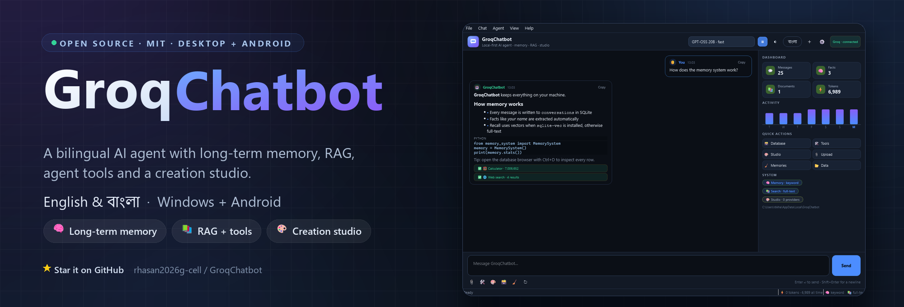
</p>

<h1 align="center">GroqChatbot</h1>

<p align="center">
  <b>A bilingual AI agent for your desktop and phone — memory, documents, tools,<br>
  and a creation studio, all running on Groq's LPU inference.</b>
</p>

<p align="center">
  <a href="https://www.python.org/"></a>
  <a href="https://doc.qt.io/qtforpython/"></a>
  <a href="https://capacitorjs.com/"></a>
  <a href="https://www.sqlite.org/"></a>
  <a href="https://console.groq.com/"></a>
  <a href="LICENSE"></a>
  <a href="https://github.com/rhasan2026g-cell/GroqChatbot/releases"></a>
</p>

<p align="center">
  <a href="#-download--run">Download</a> ·
  <a href="#-screenshots">Screenshots</a> ·
  <a href="#-what-it-can-do">Features</a> ·
  <a href="#-architecture">Architecture</a> ·
  <a href="#-build-from-source">Build</a> ·
  <a href="#-privacy--security">Privacy</a>
</p>

---

**GroqChatbot** is a local-first chat app that actually remembers. It runs as a
polished PySide6 desktop application on Windows, and as a signed 3.7 MB Capacitor
APK on Android. Conversations, facts, documents and generated media stay on your
machine — the only thing sent to Groq is the prompt you type.

Write in English, get English. Write in বাংলা, get natural Bengali. Every label,
tooltip and suggestion chip in the UI switches between the two languages instantly.

## ✨ What's new in 1.1

- **New desktop interface** — brand splash, dashboard sidebar, four stat cards, a
  7‑day activity chart, quick actions and live system badges.
- **Settings & system dialog** — five tabs (Chat & agent, API keys, Memory & RAG,
  Creation studio, About) with theme, accent colour and compact-spacing controls.
- **In-app database browser** — inspect `conversations`, `facts`, the vector index,
  `documents` and `rag_chunks`, filter, export JSON and open the data folder.
- **Tool workbench** — run any agent tool by hand, read its JSON schema and see
  exactly what the model can do; permissions for file writes, Python and network.
- **Creation studio** — image, illustration, music and video generation with
  provider detection and a gallery of recent outputs.
- **Redesigned Android app** — matching splash screen, dashboard drawer, settings
  sheet, dark/light themes and SVG icons; version 1.1.0 (versionCode 2).
- **Polished chat rendering** — GitHub-style Markdown, syntax-highlighted code,
  Unicode math (no LaTeX noise), per-message copy, regenerate and Markdown export.
- **Safer key handling** — guided three-step setup, `gsk_` validation, live test,
  show/hide, masked preview, remove; keys are stored in `.env` (desktop) or the
  app's private storage (Android), never in the repository.

## 📸 Screenshots

<p align="center">
  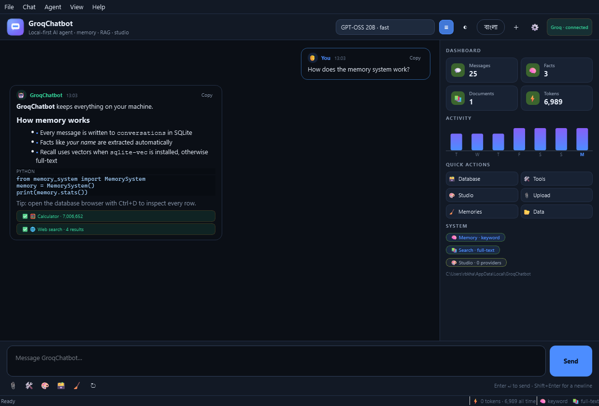
</p>
<p align="center"><i>Desktop — streaming chat, memory context and the live dashboard</i></p>

<p align="center">
  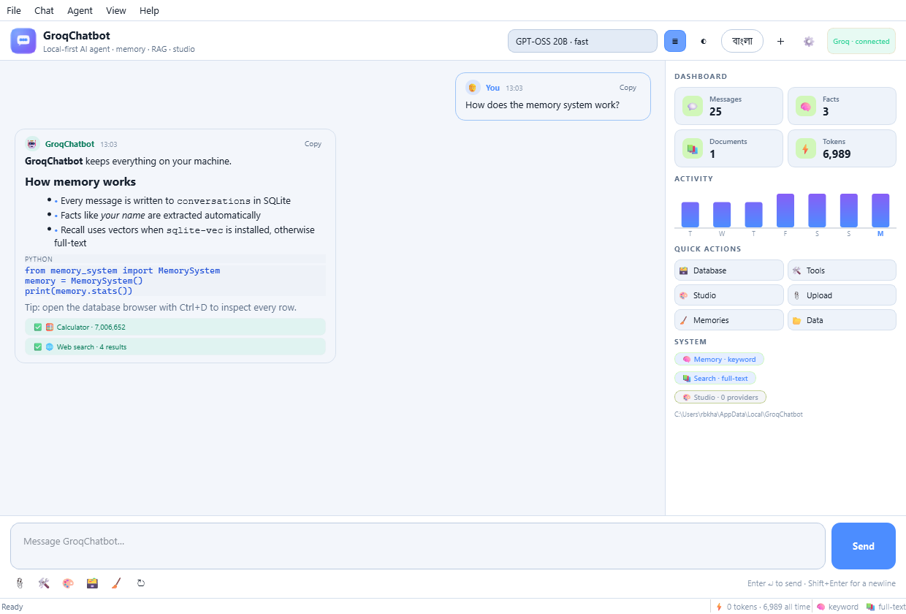
</p>
<p align="center"><i>The same workspace in the light theme</i></p>

<table align="center">
  <tr>
    <td align="center">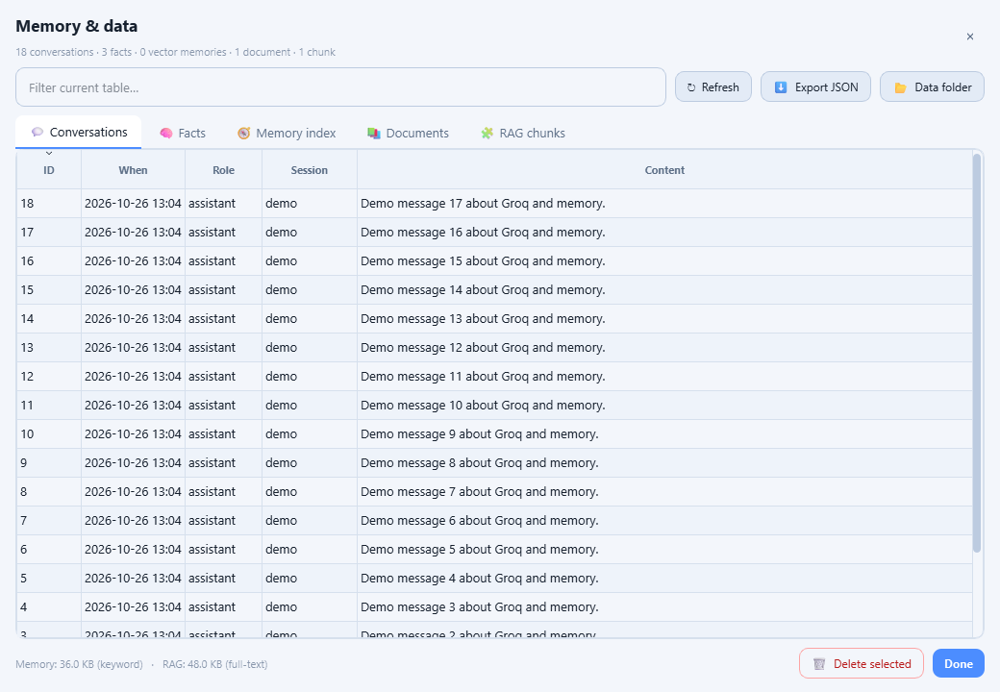<br><b>Database browser</b><br><sub>Every conversation, fact and chunk</sub></td>
    <td align="center">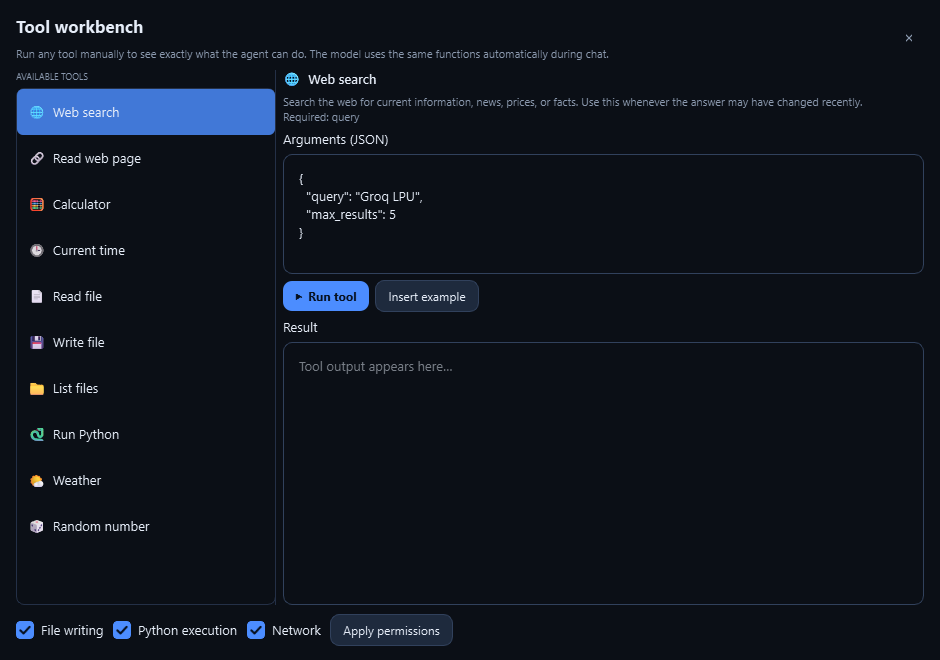<br><b>Tool workbench</b><br><sub>Run tools by hand</sub></td>
  </tr>
  <tr>
    <td align="center">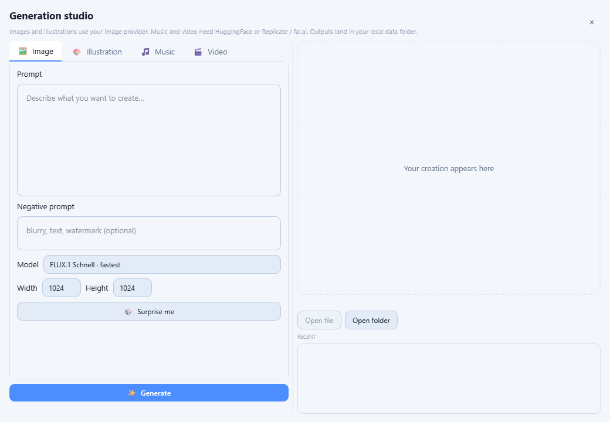<br><b>Creation studio</b><br><sub>Images, music and video</sub></td>
    <td align="center">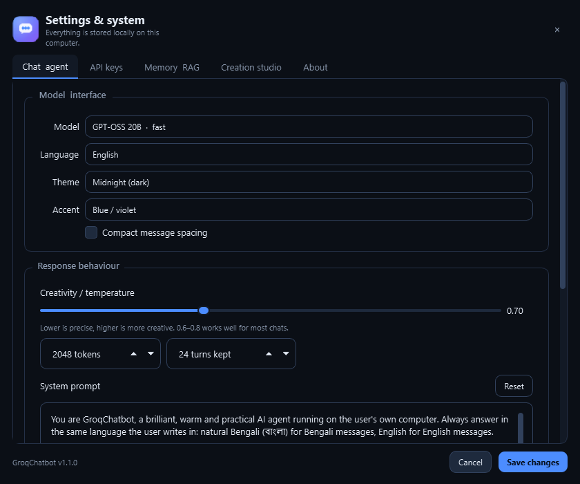<br><b>Settings &amp; system</b><br><sub>Models, keys, memory, theme</sub></td>
  </tr>
</table>

<table align="center">
  <tr>
    <td align="center">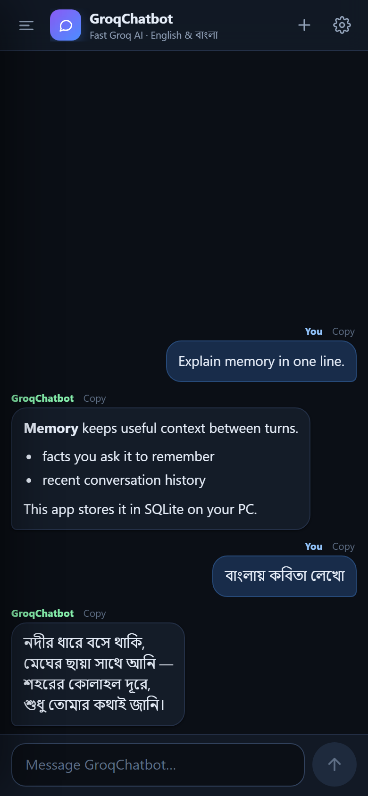<br><b>Android — dark</b></td>
    <td align="center">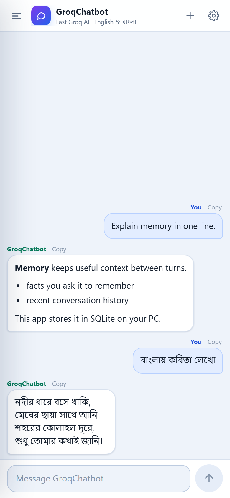<br><b>Android — light</b></td>
    <td align="center">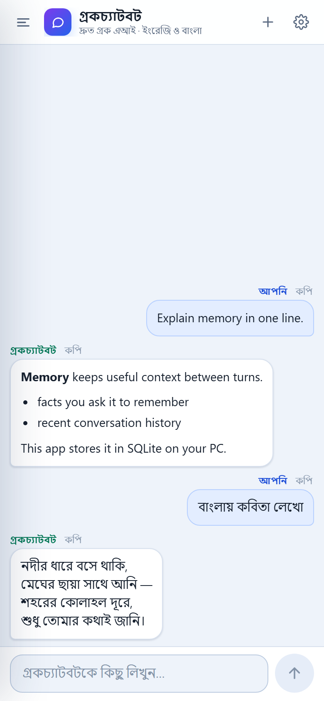<br><b>Android — বাংলা</b></td>
    <td align="center">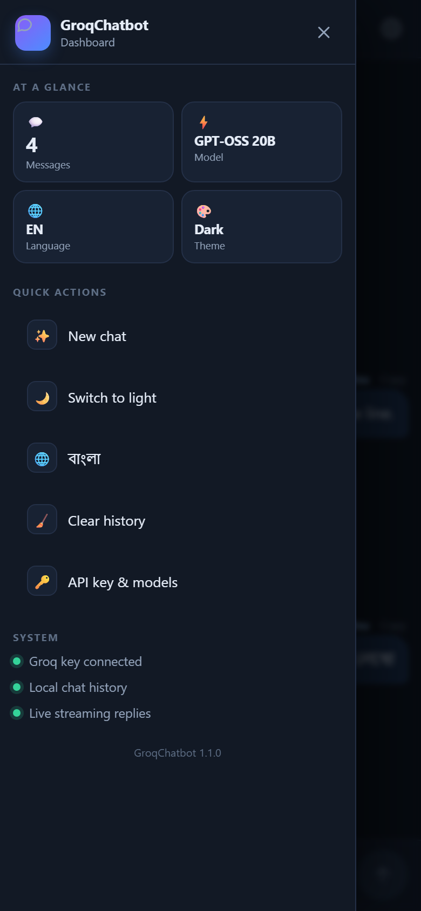<br><b>Dashboard drawer</b></td>
  </tr>
</table>

## 🎯 What it can do

### 💬 Chat that feels instant
Replies stream token by token, with a stop button that keeps the partial answer,
regenerate, copy per message and one-click Markdown export. Markdown is rendered
properly: headings, lists, quotes, tables, links and fenced code with syntax
colours. Arithmetic is normalised to Unicode symbols so `\frac{1}{2}` never leaks
into the chat.

### 🧠 Memory that survives restarts
Every message is written to SQLite. When you mention your name, city, work or a
preference, the app extracts that fact with pattern matching and stores it. On the
next question the most relevant memories are pulled back into the prompt — so you
don't repeat yourself.

- **With** `sqlite-vec` + `sentence-transformers`: semantic recall over
  `all-MiniLM-L6-v2` embeddings (384 dimensions).
- **Without** them: the app falls back to FTS5/keyword search. The dashboard says
  which mode is active, so you always know what is running.

### 📚 Chat with your documents (RAG)
Drop in a PDF, Word file, spreadsheet, HTML page or plain text. The app extracts
the text, chunks it with overlap, indexes it and cites the matching passages in
the prompt. Supported: `.pdf`, `.docx`, `.xlsx`, `.csv`, `.txt`, `.md`, `.json`,
`.html`, `.htm`.

### 🛠️ Ten agent tools
The model decides when a tool is needed, calls it, and synthesises the result.

| Tool | What it does |
|---|---|
| `web_search` | Current information, news and prices (DuckDuckGo) |
| `fetch_url` | Download a page and return readable text |
| `calculator` | Safe arithmetic, percentages, roots, trig, logs |
| `get_current_time` | Date and time in any IANA time zone |
| `read_file` | Read a UTF-8 file from your home or the app folder |
| `write_file` | Create or overwrite a file *(opt-in permission)* |
| `list_files` | Explore folders |
| `execute_python` | Run a short snippet in an isolated process *(opt-in permission)* |
| `get_weather` | Current conditions for a city |
| `random_number` | Random integer in an inclusive range |

### 🎨 Creation studio
Generate images, illustrations, music and video from a prompt, with a negative
prompt, aspect size and a gallery. Providers are auto-detected from your `.env`:

| Provider | Env var | Used for |
|---|---|---|
| HuggingFace Inference | `HUGGINGFACE_API_KEY` | Images, illustrations, music |
| Replicate | `REPLICATE_API_TOKEN` | Images, music, video |
| fal.ai | `FAL_KEY` | Images, video |
| Stability AI | `STABILITY_API_KEY` | Images |
| Together AI | `TOGETHER_API_KEY` | Images |
| OpenRouter | `OPENROUTER_API_KEY` | Images |

Models include FLUX.1 Schnell, FLUX.1 Dev, SDXL, MusicGen (small/medium/large),
Hunyuan Video and CogVideoX 5B. Only providers whose keys are present are enabled;
the studio shows how many are configured.

### 📊 A dashboard, not a mystery
The sidebar shows messages, facts, documents and tokens, a 7-day activity chart,
quick actions for the database/tools/studio/upload, and live badges for memory
mode, search mode, provider count and the exact data folder in use.

### 🌗 Two languages, two themes, four accents
English ⇄ বাংলা covers every string, including the system prompt instruction that
makes replies follow your language. Dark and light palettes are hand-tuned (not
inverted), with blue, violet, teal and rose accents.

## 🏗️ Architecture

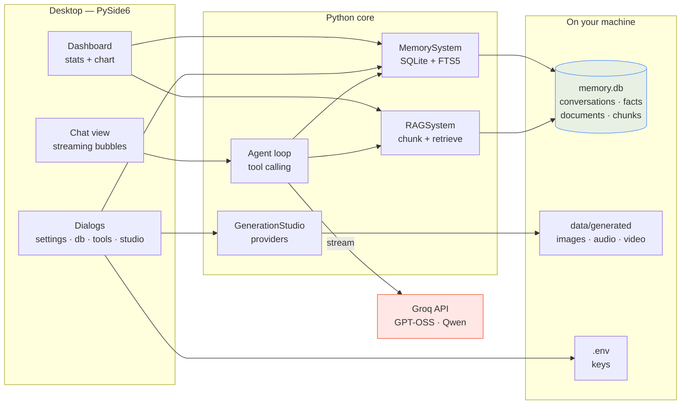

### How one message flows

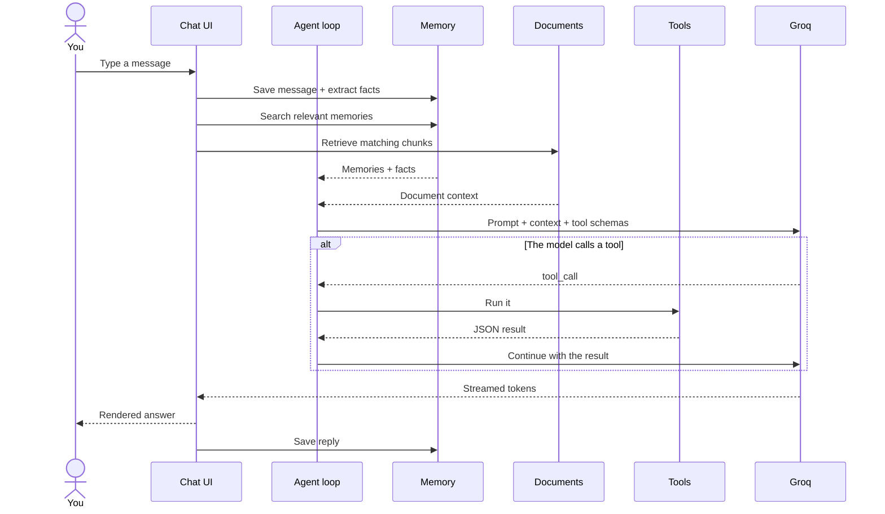

## 📁 Project structure

```text
GroqChatbot/
├── My Chatbot.py          # the desktop application (entry point)
├── app.py                 # tiny launcher — same app
├── ui_theme.py            # palettes, stylesheet, logo, splash, icon export
├── ui_widgets.py          # stat cards, badges, activity chart
├── ui_dialogs.py          # settings, database, tools, studio, key, about
├── memory_system.py       # SQLite memory, facts, optional sqlite-vec
├── rag_system.py          # document ingestion, chunking, retrieval
├── agent_tools.py         # ten tools + permissions
├── generation.py          # image/music/video providers
├── app_paths.py           # dev vs frozen data directories
├── android-app/
│   ├── www/               # the whole Android UI (HTML/CSS/JS)
│   └── android/           # Capacitor native project
├── docs/
│   ├── banner.png
│   ├── social-preview.png
│   └── screenshots/
├── assets/                # app icons used by PyInstaller
└── requirements.txt       # core desktop dependencies
```

## 🚀 Download & run

### Windows — ready-to-run EXE

1. Download **`GroqChatbot-v1.1.exe`** from [Releases](https://github.com/rhasan2026g-cell/GroqChatbot/releases).
2. Run it. No Python install needed.
3. On first launch, paste your free [Groq API key](https://console.groq.com/keys).
   The dialog walks you through creating one.

> The EXE is unsigned, so SmartScreen may show "Windows protected your PC".
> Choose **More info → Run anyway** — the source is in this repository.

### Android — signed APK

1. Download **`GroqChatbot-v1.1.apk`** from [Releases](https://github.com/rhasan2026g-cell/GroqChatbot/releases).
2. Allow "install unknown apps" for your file manager, then tap the APK.
3. Open **GroqChatbot** and connect your key in the guided sheet.

Android 5.1 (API 22) or newer. See [ANDROID.md](ANDROID.md) for details.

### From source

```bash
git clone https://github.com/rhasan2026g-cell/GroqChatbot.git
cd GroqChatbot

python -m venv .venv
.venv\Scripts\activate          # Windows
# source .venv/bin/activate     # macOS / Linux

pip install -r requirements.txt
python "My Chatbot.py"
```

Optional upgrades (semantic memory, better `.docx` extraction):

```bash
pip install -r requirements-optional.txt
```

## ⚙️ Configuration

Copy `.env.example` to `.env` and fill in what you need. Only `GROQ_API_KEY` is
required.

```env
# Required
GROQ_API_KEY=gsk_...

# Optional generation providers
HUGGINGFACE_API_KEY=
REPLICATE_API_TOKEN=
STABILITY_API_KEY=
FAL_KEY=
TOGETHER_API_KEY=
OPENROUTER_API_KEY=

# Agent tuning
EMBEDDING_MODEL=sentence-transformers/all-MiniLM-L6-v2
MEMORY_ENABLED=true
RAG_ENABLED=true
AGENT_MODE=true
MAX_MEMORY_RESULTS=10
MAX_RAG_RESULTS=3
```

The desktop app writes the key to `.env` for you (right next to the source, or in
`%LOCALAPPDATA%\GroqChatbot` for the packaged EXE). Data lives in `data/` while
developing and in `%LOCALAPPDATA%\GroqChatbot` when frozen — the dashboard always
shows the exact path.

## 🔨 Build from source

### Desktop EXE

```powershell
pip install -r requirements.txt
python -m PyInstaller --noconfirm --clean --onefile --windowed ^
  --name GroqChatbot-v1.1 --icon assets\app_icon.ico ^
  --hidden-import groq --collect-all groq "My Chatbot.py"
# → dist\GroqChatbot-v1.1.exe
```

### Android APK

```powershell
$env:JAVA_HOME    = "C:\Program Files\Eclipse Adoptium\jdk-17.0.20.101-hotspot"
$env:ANDROID_HOME = "C:\Android\sdk"

cd android-app
npx cap sync android
cd android
.\gradlew.bat assembleRelease
# → app\build\outputs\apk\release\app-release.apk
```

Capacitor 6 is pinned on purpose: Capacitor 7 needs JDK 21 and SDK 35. The app
talks to Groq directly from the WebView; no backend or proxy is involved.

## 🔐 Privacy & security

- **No backend, no telemetry, no accounts.** There is nothing between you and Groq.
- **Keys stay local.** `.env` and the Android app's private storage only. `.env`,
  keystores and databases are git-ignored.
- **Memory stays local.** SQLite files live in your data folder; nothing is synced.
- **Tool permissions are explicit.** File writes, Python execution and network
  access can each be switched off in the Tool workbench.
- **Generated media stays local.** Outputs land in `data/generated/`.
- Android traffic goes only to `api.groq.com` (and the generation provider you
  configure, on desktop).

Found a problem? Open an issue or read [SECURITY.md](SECURITY.md).

## ⚠️ Honest limitations

- **Android is chat-only.** Memory, RAG, tools and the studio are desktop features.
  The phone keeps history locally and streams replies.
- **Semantic recall is optional.** Without `sqlite-vec` and
  `sentence-transformers`, memory search uses FTS5 keywords — good, not magic.
  The dashboard shows which mode is active.
- **Video generation is experimental.** Provider queues and formats vary; failures
  are reported in the studio instead of being hidden.
- **Weather uses a free public endpoint.** It can rate-limit; the model is told to
  say so and continue.
- **The EXE is unsigned.** SmartScreen warnings are expected for sideloaded builds.

## 🗺️ Roadmap

- [ ] Streaming on Android through a shared event parser with desktop
- [ ] Local embeddings bundled so semantic memory works out of the box
- [ ] Conversation branching and full-text search inside the app
- [ ] More providers and an image-to-image workflow
- [ ] macOS / Linux packaging

## 🤝 Contributing

Issues and pull requests are welcome. Please read [CONTRIBUTING.md](CONTRIBUTING.md)
first, keep the UI bilingual, and never commit keys or databases.

```bash
git checkout -b feature/your-idea
# make changes
git commit -m "Add your idea"
git push origin feature/your-idea
```

## 📄 License

MIT — see [LICENSE](LICENSE).

## 🙏 Built with

[Groq](https://groq.com/) · [PySide6](https://doc.qt.io/qtforpython/) ·
[SQLite](https://sqlite.org/) · [sqlite-vec](https://github.com/asg017/sqlite-vec) ·
[sentence-transformers](https://www.sbert.net/) · [Capacitor](https://capacitorjs.com/) ·
[Pillow](https://python-pillow.org/)

## 🔎 Topics

`groq` · `ai-agent` · `bilingual` · `bengali` · `bangla` · `pyside6` ·
`desktop-app` · `android` · `capacitor` · `llm` · `rag` · `sqlite-vec` ·
`long-term-memory` · `tool-calling` · `image-generation` · `music-generation` ·
`local-first` · `privacy` · `python`

---

<p align="center">
  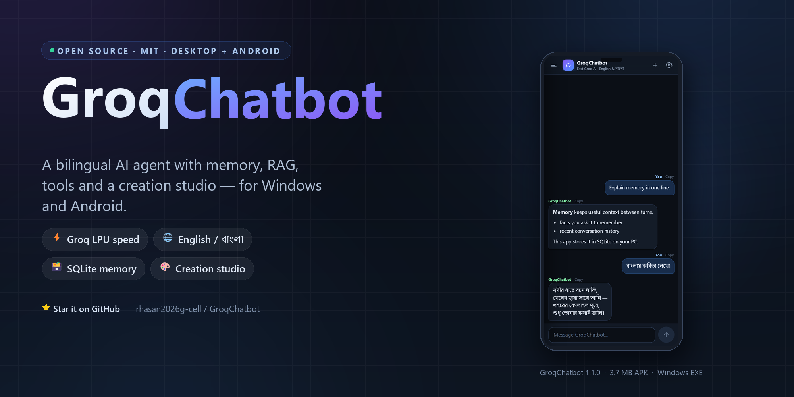
</p>

<p align="center">
  Made with care by <a href="https://github.com/rhasan2026g-cell">rhasan2026g-cell</a><br>
  <sub>Powered by Groq LPUs · Python on the desktop · JavaScript on the phone</sub>
</p>
